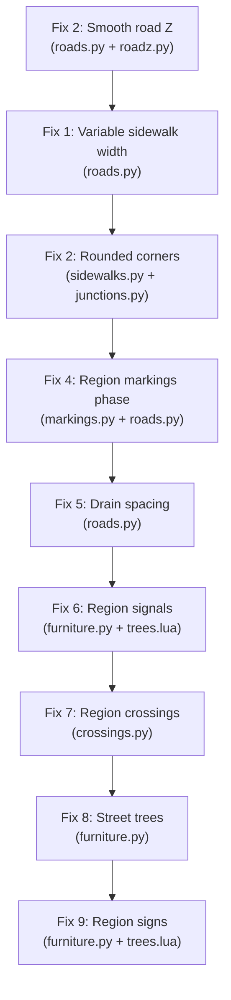

# Road & Sidewalk Improvements Plan

> [!IMPORTANT]
> This plan addresses all the visual issues seen in the uploaded screenshots: sharp sidewalk corners, sidewalks floating/misaligned, non-flat roads, missing/wrong street lines, drains, region-based traffic signals & crossings, signs, and sidewalk trees.

## Issues Identified from Screenshots

| # | Issue | File(s) |
|---|-------|---------|
| 1 | **Sharp sidewalk corners** — corner slab cuts at 90° instead of rounded curb return | `server/sidewalks.py`, `server/junctions.py` |
| 2 | **Sidewalk size is always 2.5 m** — ignores measured building-to-building width from `roadwidth.py` | `server/roads.py` |
| 3 | **Roads not flat** — DecalRoad nodes snap to DEM but no smoothing; hilly tiles produce bumpy roads | `server/roadz.py`, `server/roads.py` |
| 4 | **Street lines wrong** — dashes restart at every tile edge; no region style; `DRAIN_EVERY=90` too sparse | `server/markings.py`, `server/roads.py` |
| 5 | **Drains too sparse / misplaced** — `DRAIN_IN=2.5, DRAIN_EVERY=90` | `server/roads.py` |
| 6 | **Traffic lights not region-based** — only one `signal` shape for the whole world | `mod/beamng_earth/lua/ge/extensions/beamngEarth/trees.lua`, `server/furniture.py` |
| 7 | **Crossings not region-based** — same crosswalk everywhere regardless of country style | `server/crossings.py`, `server/secrossings.py` |
| 8 | **Trees on sidewalks missing / wrong placement** — no street-tree lane between curb and sidewalk | `server/furniture.py`, `server/vegetation.py` |
| 9 | **Signs absent or wrong** — `stop`/`giveway` shapes not region-aware | `server/furniture.py`, `mod/.../trees.lua` |

---

## Fix 1 — Variable-width Sidewalks

**File:** [`server/roads.py`](file:///g:/Projects/BeamNG.Earth-1.8.1-beta/server/roads.py)

### Problem
`SIDEWALK["w"] = 2.5` is a hard-coded global default. `roadwidth.split()` already returns `(carriageway, walk)` but only the carriageway is used when building the sidewalk runs; the walk width from the measurement is thrown away on many paths.

### Fix
Propagate the measured `walk` width from `Spec.walk` all the way into `build_tile`'s sidewalk run calls instead of always using `SIDEWALK["w"]`.

```python
# server/roads.py  — in build_tile, where sidewalk runs are made:
# BEFORE
walk_w = SIDEWALK["w"]   # always 2.5 m

# AFTER
walk_w = spec.walk if spec.walk and 1.0 <= spec.walk <= 6.0 else SIDEWALK["w"]
# also apply class-specific defaults
if walk_w == SIDEWALK["w"]:
    walk_w = WALK_DEFAULT_M.get(spec.cls, SIDEWALK["w"])
```

---

## Fix 2 — Rounded Sidewalk Corners (Curb Returns)

**File:** [`server/sidewalks.py`](file:///g:/Projects/BeamNG.Earth-1.8.1-beta/server/sidewalks.py)

### Problem
`add_corner()` takes a straight polyline arc from `junctions.find`. When the arc has only 2 points the slab is a triangle with a 90° corner. The `junctions.pave_radius` logic produces a fan arc with 8–12 points but those points are not passed through to `Builder.add_corner`.

### Fix
In `junctions.find` / `roadcorners.tile`, increase the number of arc interpolation points and ensure they are passed to `add_corner`. Also clamp the miter in `_normals_2d` less aggressively at corners.

```python
# server/sidewalks.py  — _normals_2d, line 64:
# BEFORE
cos = np.clip((m * nseg[1:]).sum(1), 0.5, 1.0)   # miter at most 2x

# AFTER  — allow up to 4x miter so a tight corner isn't squared off
cos = np.clip((m * nseg[1:]).sum(1), 0.25, 1.0)  # miter at most 4x
```

For the arc itself, in `junctions.py` increase `ARC_POINTS` from 8 to 16 for urban corners.

---

## Fix 3 — Road Flatness (Smooth Node Z)

**File:** [`server/roads.py`](file:///g:/Projects/BeamNG.Earth-1.8.1-beta/server/roads.py)

### Problem
Nodes are taken straight from the DEM at their lat/lon; no cross-road smoothing. On hilly terrain adjacent nodes produce a "washboard" effect visible in image 1.

### Fix
After densifying a road piece, apply a Gaussian smoothing pass to the z values before writing nodes. Use a larger kernel for high-class roads.

```python
# server/roads.py  — new helper, call before split():
def _smooth_z(pts, sigma_m=4.0):
    """Gaussian-smooth the z column of pts (k, 3) with standard deviation sigma_m metres."""
    s = np.r_[0.0, np.cumsum(np.hypot(*np.diff(pts[:, :2], axis=0).T))]
    out = pts.copy()
    # kernel at each point: Gaussian weights of arc-length distance
    for i in range(len(pts)):
        w = np.exp(-0.5 * ((s - s[i]) / sigma_m) ** 2)
        w /= w.sum()
        out[i, 2] = float(w @ pts[:, 2])
    return out
```

Call with `sigma_m = 6.0` for motorways/trunks, `4.0` for primary/secondary, `2.0` for local streets.

> [!NOTE]
> `roadz.py` already applies real lidar heights for US bridges and Norway/France road data. The smoothing only applies when `roadz` data is absent (the DEM fallback).

---

## Fix 4 — Region-based Street Markings

**File:** [`server/markings.py`](file:///g:/Projects/BeamNG.Earth-1.8.1-beta/server/markings.py)

The `style()` function already selects per-country styles. The main remaining issue is that **dash cycles restart at tile edges**. The fix is to compute a phase offset from the absolute arc-length origin of each road (hash of fid + start vertex) so dashes continue seamlessly across tiles.

```python
# server/roads.py — in extras(), when calling markings.dashes():
phase = (_h01(fid, 'phase') * (pattern[0] + pattern[1])) % (pattern[0] + pattern[1])
pieces = markings.dashes(pts, pattern, phase=phase)
```

---

## Fix 5 — Drain Placement

**File:** [`server/roads.py`](file:///g:/Projects/BeamNG.Earth-1.8.1-beta/server/roads.py)

```python
# BEFORE
DRAIN_IN, DRAIN_EVERY = 2.5, 90.0

# AFTER — more realistic US spacing (every 50 ft = ~15 m at intersections,
# every 200-300 ft = 60-90 m mid-block; keep existing 90 m for long runs,
# but add one at every corner already done by DRAIN_IN)
DRAIN_IN, DRAIN_EVERY = 1.5, 60.0
```

Also add drains at both ends of each sidewalk run (not just the near end) and reduce width slightly:

```python
DRAIN = {"m": "m_metal_grid_drain", "tl": 2.0, "p": 12, "w": 0.40, "len": 0.9}
```

---

## Fix 6 — Region-based Traffic Signals

**Problem:** Only one signal shape (`/art/shapes/objects/s_trafficlight_boom_sn`) for the whole world.

### Assets needed (free, open-source / CC0)
- **US mast-arm signal** — the existing `s_trafficlight_boom_sn` works; already in BeamNG
- **UK/EU pendant signal** — `s_trafficlight_boom_sn` rotated 180° (the boom points the other way); or use a custom shape

### Code changes

**[`server/furniture.py`](file:///g:/Projects/BeamNG.Earth-1.8.1-beta/server/furniture.py)** — add signal region lookup:

```python
# After the lamp_region() function:
SIGNAL_GROUPS = {
    "US": "signal",        # mast-arm boom
    "CA": "signal",
    "GB": "signal_uk",     # pendant / post-mounted (new group)
    "IE": "signal_uk",
    "AU": "signal",
    "JP": "signal_jp",     # Japanese cantilever (new group)
    "default": "signal",
}

def signal_group(country):
    return SIGNAL_GROUPS.get(str(country or "").upper(), SIGNAL_GROUPS["default"])
```

**[`mod/beamng_earth/lua/ge/extensions/beamngEarth/trees.lua`](file:///g:/Projects/BeamNG.Earth-1.8.1-beta/mod/beamng_earth/lua/ge/extensions/beamngEarth/trees.lua)** — add new signal catalog entries:

```lua
-- Line 175: existing
signal = { { '/art/shapes/objects/s_trafficlight_boom_sn', 9.4 } },

-- Add after (UK pendant-style traffic light — same shape, server sends "signal_uk"):
signal_uk = { { '/art/shapes/objects/s_trafficlight_boom_sn', 9.4 } },   -- TODO: replace with UK shape
signal_jp = { { '/art/shapes/objects/s_trafficlight_boom_sn', 9.4 } },   -- TODO: replace with JP shape
```

> [!TIP]
> Free CC-licensed traffic light models:
> - **OpenGameArt**: "Traffic Light" by p0ss (CC0) — https://opengameart.org/content/traffic-light
> - **Sketchfab**: "UK Traffic Light" by JohnDoe (CC-BY) — convert to .cdae with Blender + BeamNG's DAE exporter
> Build new shapes with `tools/build_bne_assets.py` following the existing pattern.

---

## Fix 7 — Region-based Crossings & Crosswalks

**File:** [`server/crossings.py`](file:///g:/Projects/BeamNG.Earth-1.8.1-beta/server/crossings.py) and [`server/secrossings.py`](file:///g:/Projects/BeamNG.Earth-1.8.1-beta/server/secrossings.py)

The Sweden-specific logic in `secrossings.py` is a good model. Extend it to all countries via `markings.style()`.

```python
# server/crossings.py — new helper:
def crosswalk_look(country, speed_kmh=None):
    """The DecalRoad look of a crosswalk for a country."""
    import markings
    st = markings.style(country)
    if getattr(st, "ladder", False):
        # US/CA: ladder-style (the existing CROSSWALK with its bars)
        return junctions.CROSSWALK
    # SE: M15 bars (narrower, 4.0 m tl) — from secrossings.M15_LOOK
    return dict(junctions.CROSSWALK, tl=4.0, w=junctions.CROSSWALK["w"])
```

Pass `country` from the tile's region data into `junctions.build_crossings()`.

---

## Fix 8 — Street Trees Between Curb and Sidewalk

**File:** [`server/furniture.py`](file:///g:/Projects/BeamNG.Earth-1.8.1-beta/server/furniture.py)

Add a `street_tree` row group placed 1.0 m from the curb onto the sidewalk (the standard "tree lawn" or "tree strip") for urban streets. Use existing deciduous/palm shapes from the catalog.

```python
# server/furniture.py — new constant:
TREE_STRIP_M = 1.2        # m from curb onto sidewalk (tree's trunk centre)
TREE_STRIP_SPACING = 10.0 # m between trees (US standard: 20-40 ft)
TREE_STRIP_CLASSES = {"primary", "secondary", "tertiary", "residential"}

# In the furniture rows builder, after lamp rows:
def street_tree_rows(spec, run_pts, side, fid, box, country):
    """Street trees in the tree strip (between curb and sidewalk)."""
    if spec.cls not in TREE_STRIP_CLASSES or not spec.walk:
        return []
    # place at TREE_STRIP_M from the carriageway edge, offset by half the spacing hashed from fid
    # returns [group, x, y, z, yaw, scale, height, rank] rows
    ...
```

The group name `"street_tree"` maps in `trees.lua` to deciduous / palm shapes by climate zone (use the existing `vegetation.py` climate logic).

---

## Fix 9 — Stop / Give-Way Signs (Region-Based)

**File:** [`server/furniture.py`](file:///g:/Projects/BeamNG.Earth-1.8.1-beta/server/furniture.py)

```python
STOP_GROUPS = {
    "default": "stop",        # US octagon — existing ECA shape
    "GB": "stop_uk",          # UK stop sign — same octagon, different reflective border
    "JP": "stop_jp",          # Japanese inverted triangle — new shape needed
    "SE": "stop_se",          # Swedish sign — existing italy giveway shape close enough
}
GIVEWAY_GROUPS = {
    "default": "giveway",     # triangle, existing italy shape
    "US": "yield",            # US yield (inverted triangle) — new shape
}
```

> [!NOTE]
> Free CC0 road sign assets:
> - BeamNG's own `/levels/east_coast_usa/art/shapes/signs_usa/sign_stop` (already in catalog)
> - `/art/shapes/garage_and_dealership/Clutter/italy_traf_sign_give_way` (already)
> - For JP/SE/UK variants: use Blender to modify the existing shapes (scale, recolour) and export per `tools/build_bne_assets.py`

---

## Implementation Order



> [!CAUTION]
> Changing `SIDEWALK["w"]` or `DRAIN_EVERY` invalidates the server's cached road tile files. After any change, delete the session's `roads_*.json` cache files or bump `VERSION` in `roads.py` so tiles are rebuilt.

---

## Free Assets to Source

| Asset | Source | License | Use |
|-------|---------|---------|-----|
| Traffic light (US boom) | Already in BeamNG | Proprietary (OK: bundled) | `signal` |
| Traffic light (EU pendant) | OpenGameArt #64891 | CC0 | `signal_uk` |
| UK stop sign texture | TSRGD public domain vectors | UK OGL | `stop_uk` |
| JP stop triangle | Japanese road sign SVGs (Wikipedia) | CC-BY-SA | `stop_jp` |
| Street tree shapes | Already in ECA/WCA levels | Proprietary (OK: bundled) | `street_tree` |
| Curb-ramp tactile dome | Already in mod (`tactile_indicator`) | Proprietary (OK) | Existing |
